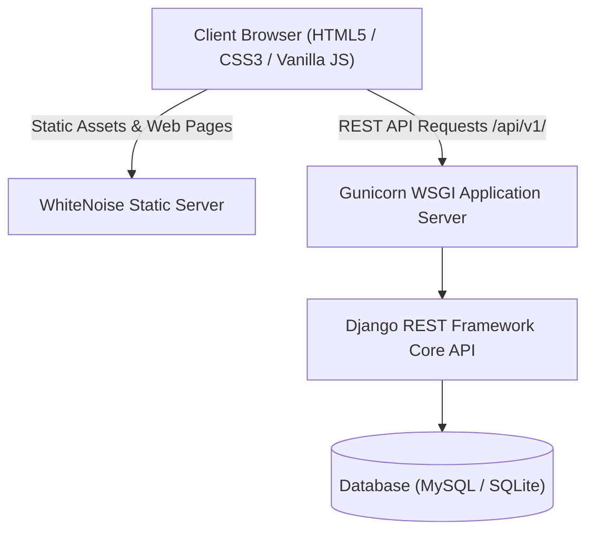

# 📚 BookBridge — Bridge Books. Build Minds.

> **India's premier student platform to Buy, Sell, Exchange, and Donate academic books and resources across colleges.**

[](https://render.com/deploy)
[](https://www.djangoproject.com/)
[](https://www.django-rest-framework.org/)
[](LICENSE)
[](https://book-bridge-2-5dbv.onrender.com/)

---

## 🌟 Overview

**BookBridge** empowers college and university students to make textbooks and academic resources more affordable, accessible, and eco-friendly. Students can:
- 🛒 **Buy pre-owned textbooks** at up to 80% discount compared to MRP.
- 🏷️ **Sell used books** directly to peers without middleman cuts.
- 🔄 **Swap textbooks** with semester peers (100% free exchanges).
- 🎁 **Donate books** to juniors and underprivileged students.
- 🔍 **Filter by GTU Subject Code**, department (CE, IT, EE, ME, Civil, EC, IC), and semester.

---

## 🏗️ Architecture & Tech Stack



| Component | Technology | Description |
| :--- | :--- | :--- |
| **Frontend** | HTML5, CSS3, Vanilla JavaScript (ES6+), FontAwesome 6 | Responsive, zero-framework, fast-loading UI with PWA capabilities |
| **Backend** | Python 3.11+, Django 5.0, Django REST Framework | Robust modular RESTful architecture |
| **Authentication**| JWT (JSON Web Tokens) via `djangorestframework-simplejwt` | Stateless authentication with refresh token rotation |
| **Database** | MySQL 8.0 (Production) / SQLite3 (Development/Render Fallback) | Relational data persistence with migrations |
| **WSGI / Serving**| Gunicorn + WhiteNoise | Production-grade WSGI server with compressed asset caching |

---

## 🚀 Quick Start (Local Development)

### 1. Clone the repository
```bash
git clone https://github.com/Edith1-ux/book-bridge-2.git
cd book-bridge-2
```

### 2. Create and activate a virtual environment
```bash
# Windows
python -m venv .venv
.venv\Scripts\activate

# Linux / macOS
python3 -m venv .venv
source .venv/bin/activate
```

### 3. Install dependencies
```bash
pip install -r backend/requirements.txt
```

### 4. Run database migrations & seed starter data
```bash
python backend/manage.py migrate
python backend/manage.py seed_db
```

### 5. Start the development server
```bash
python backend/manage.py runserver
```

Open [http://127.0.0.1:8000](http://127.0.0.1:8000) in your browser.

---

## 🌐 Deploying to Render

1. Fork or push this repository to GitHub.
2. In the [Render Dashboard](https://dashboard.render.com/):
   - Click **New +** → **Blueprint** and select your repository.
   - Or create a **Web Service** with:
     - **Runtime**: `Python 3`
     - **Build Command**: `pip install -r backend/requirements.txt && python backend/manage.py collectstatic --noinput`
     - **Start Command**: `python backend/manage.py migrate --noinput || true; python backend/manage.py seed_db || true; gunicorn --chdir backend config.wsgi:application --bind 0.0.0.0:$PORT --workers 2 --threads 4 --timeout 120`
3. Optional environment variables (for external MySQL):
   - `MYSQL_HOST`, `MYSQL_PORT`, `MYSQL_DATABASE`, `MYSQL_USER`, `MYSQL_PASSWORD`

---

## 📁 Repository Structure

```text
book-bridge-2/
├── backend/                  # Django backend application
│   ├── apps/                 # Modular domain applications
│   │   ├── admin_portal/     # Admin analytics and metrics
│   │   ├── ai/               # AI recommendation and assistant endpoints
│   │   ├── analytics/        # Platform analytics and event tracking
│   │   ├── books/            # Book listings, search, wishlist
│   │   ├── chat/             # Direct messaging between students
│   │   ├── colleges/         # Universities, branches, syllabus codes
│   │   ├── donations/        # Book donation and claim workflow
│   │   ├── exchange/         # Book swap / exchange proposals
│   │   ├── marketplace/      # Direct buy/sell orders and inquiries
│   │   ├── notifications/    # In-app student alerts
│   │   ├── payments/         # Payment intent handlers
│   │   └── users/            # Custom User model, profile, JWT auth
│   ├── config/               # Django project settings, WSGI, URLs
│   ├── db.sqlite3            # Pre-seeded development database
│   ├── manage.py             # Django CLI management entrypoint
│   └── requirements.txt      # Python dependencies
├── css/                      # Modular stylesheets & design tokens
├── js/                       # Unified API client & application controllers
│   ├── api.js                # DRF REST API client layer
│   ├── app.js                # Page controller & UI component bindings
│   ├── database.js           # Client adapter
│   └── live-stats.js         # Animated live metrics engine
├── browse_images/            # Book imagery & mock assets
├── index.html                # Homepage
├── browse.html               # Book catalog & search interface
├── exchange.html             # Book exchange platform
├── donate.html               # Book donation portal
├── login.html                # Student login page
├── register.html             # Student signup page
├── dashboard.html            # User account & listings management
├── admin.html                # Moderator dashboard
├── render.yaml               # Render Infrastructure-as-Code Blueprint
├── Dockerfile                # Production container specification
└── README.md                 # Project documentation
```

---

## 🔒 Security & Best Practices

- **Zero Hardcoded Secrets**: All keys and credentials are read from environment variables.
- **CSRF & CORS Hardened**: Restricted to authorized origins in production mode.
- **Stateless Authentication**: Secured with JWT bearer tokens.
- **Safe SQL Execution**: Fully managed via Django ORM parameterized queries.

---

## 📄 License

This project is licensed under the [MIT License](LICENSE).

